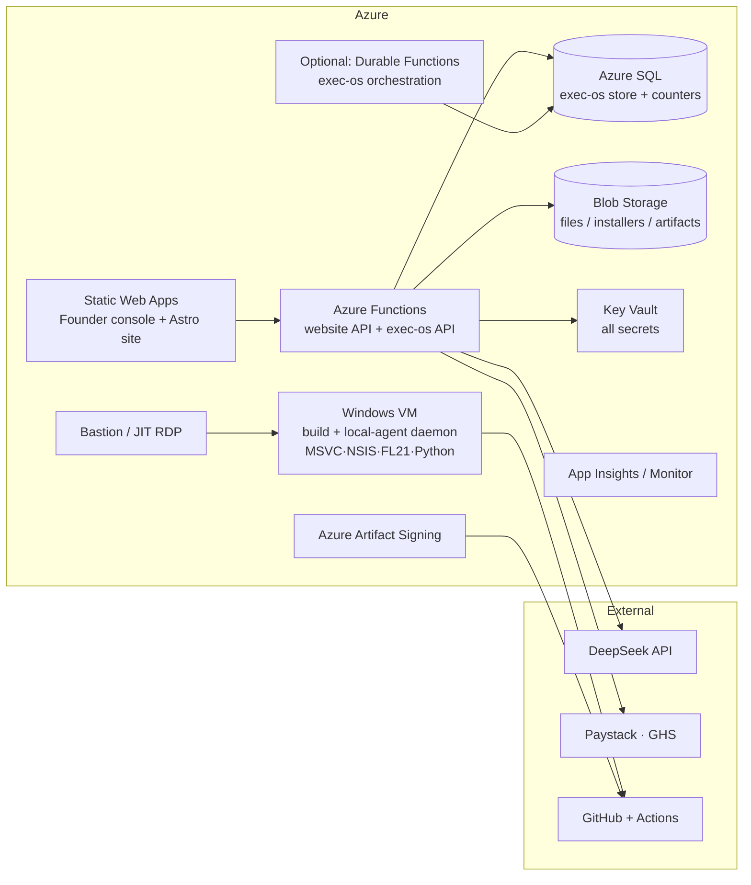

# DECISION — Azure Migration: Complexity Analysis & Plan

**Date:** 2026-08-30
**Author:** Copilot (with Khritical)
**Status:** SUPERSEDED — decision taken = HYBRID. Execution plan: `dec_azure-migration-hybrid-plan.md`.
**Goal:** Retire the Windows laptop. Migrate "everything" to Azure.
**Scope reviewed:** executive-os, zarlino-website, JUCE plugin build/release pipeline, the local agent daemon, CI/CD, data, secrets, and the 20-plugin / 2,044-test-unit roadmap.

> **Outcome of this analysis (2026-08-30):** Hybrid adopted. Laptop role → Azure VM; website → SWA + Functions; data/signing → Azure; **Executive OS stays on Cloudflare** (full rewrite deferred, go/no-go trigger in the hybrid plan §Phase 5). The KV bridge decision (D1) is the one architectural choice that keeps the Executive OS untouched.

---

## 0. TL;DR

| Workload | Azure target | Complexity | Effort |
|---|---|---|---|
| Local agent daemon (laptop-bound worker) | Always-on Windows VM | **LOW–MED** | 2–3 days |
| Website (Astro + API) | Azure Static Web Apps + Functions | **LOW** | 3–5 days |
| Data, files, secrets | Azure SQL / Blob / Key Vault | **LOW–MED** | 2–3 days |
| CI/CD (already cloud) | Keep GH Actions (or Azure Pipelines) | **LOW** | 1–2 days |
| Code signing | Azure Artifact Signing | **LOW** (already researched) | 1 day |
| **Executive OS (the big one)** | Azure Functions + Durable Functions + Azure SQL | **HIGH** | **2–4 weeks** |
| Real-DAW / audio-hardware QA | — (cannot be fully reproduced) | **BLOCKER** | partial only |

**Total realistic effort for "100% on Azure": ~4–8 weeks**, of which the Executive OS rewrite is 50–60%.

**Recommendation: HYBRID — ADOPTED.** The laptop is retired by moving (1) the daemon to an Azure VM, (2) the website to Azure, (3) data/secrets to Azure, (4) signing to Azure — **while the Executive OS stays on Cloudflare** (it is already cloud-native, cost ~$0–5/mo, and does not depend on the laptop). The Executive OS full rewrite to Azure is the only part that is genuinely expensive and risky; it is deferred with a go/no-go gate. Execution plan: `dec_azure-migration-hybrid-plan.md` (~2–3 weeks to a retired laptop).

---

## 1. What "everything" actually is (inventory)

### 1.1 Cloud services today
- **Executive OS** — `executive-os/` on Cloudflare Workers:
  - `ExecutiveAgent` Durable Object (instance `zarlino`), SQLite embedded (31 tables, migrations v1–v19), alarms + `keepAlive`, cron `0 */6 * * *` (System Doctor).
  - `ZARLINO_KV` (shared with the website): revenue/license counters + affiliate program.
  - Static assets: React+Vite Founder console (`web/dist` via `env.ASSETS`).
  - REST API + SSE streaming chat (buffered through `chat_streams`, polled by the worker).
  - ~60 agent tools, authority engine (approvals / delegate / full-access), System Doctor (15 checks), local-task lease/reap machinery, budget/token tracking.
  - Test suite ~150+ tests; CI validates on push.
- **Website** — `zarlino-website/` (Astro static + Cloudflare Worker API):
  - Paystack checkout (GHS-only account), server-authoritative license build, affiliate enrolment/reporting, `/admin`.
  - `ZARLINO_KV` shared namespace.
- **CI/CD (GitHub Actions — already cloud, no laptop dependency):**
  - `executive-os-ci.yml` (typecheck + tests + wrangler dry-run).
  - `ztame-release-gate.yml` (Windows hosted runner: CMake + MSVC build, ctest, NSIS installer, artifact upload).
  - `zarlino-website/.github/workflows/deploy.yml` (Astro build → Cloudflare deploy).
- **GitHub repos:** `zarlino-audio/Zarlino` (private, JUCE submodule), `zarlino-website`, `zarlino-feedback`.

### 1.2 The laptop-bound component (the real anchor)
`executive-os/scripts/local-daemon.ts` + `local-agent.ts` is an **always-on production worker**, not a dev convenience:
- Claims PENDING local tasks from the live worker, heartbeats leases, posts results back.
- Health-beacon endpoint so the System Doctor can flag the machine as offline.
- Local tools that do physical work: `local_build_plugin`, `local_plugin_tests`, `local_render_ab`, `local_fl_launch_test`, `local_package_release`, `local_ship_check`, `local_new_plugin`, `local_plugin_ui`, `local_deploy_website`, `local_web_search`.
- **Hardcoded machine paths** (must exist on whatever replaces the laptop):
  - `REPO_ROOT = …/plugin`
  - `C:\Program Files\Image-Line\FL Studio 21\FL64.exe`
  - `C:\Program Files\Common Files\VST3`
  - `C:\Users\khrit\AppData\Local\Python\pythoncore-3.14-64\Scripts` (cmake.exe / ninja.exe)
  - `C:\Program Files (x86)\NSIS\makensis.exe`
  - `C:\Program Files\Microsoft Visual Studio\18\Community\VC\Auxiliary\Build\vcvars64.bat`
  - `python` (3.14 + numpy/scipy on PATH)
  - `artifacts/` scratch + PowerShell temp-file redirection (`_ps_out.txt` / `_ps_err.txt`)

### 1.3 Data & secrets
- Executive OS SQLite (31 tables: products, tasks, decisions, risks, finance, doctrine, policies, memories, productivity, calendar/notes/reminders/contacts, uploaded_files (base64, ≤5 MB), chat, agent_jobs, settings, doctor_logs, auth, local_tasks…).
- KV counters + affiliate records; website static content.
- Secrets: `DEEPSEEK_API_KEY`, `FOUNDER_AUTH_TOKEN`, `GITHUB_TOKEN`, `CF_API_TOKEN`, `PAYSTACK_SECRET_KEY` (LIVE, GHS), `ZARLINO_LICENSE_PRIVATE_KEY`, `CLOUDFLARE_API_TOKEN`/`CLOUDFLARE_ACCOUNT_ID`, `ADMIN_TOKEN`.

### 1.4 Roadmap load (why "now")
- Specs target 20 plugins (8 scaffolded today), 2,044 automated test units, host-compat matrix (VST3/AU/AAX × Windows/macOS × Debug/Release), plus RACK_AI (16-slot AI rack) — the CI/QA surface only grows from here. Migrating now (small footprint) is cheaper than later.

---

## 2. Target architecture on Azure

| Current | Azure equivalent | Notes |
|---|---|---|
| Cloudflare Workers (exec-os API) | Azure Functions (Node 22) | pay-per-use; streaming responses supported |
| Durable Object + SQLite | Azure Durable Functions + **Azure SQL** | the hard part — see §4 |
| KV (shared counters/affiliate) | Azure Table Storage / Cosmos DB / Redis | shared store must serve BOTH site + exec-os |
| React console + Astro site | Azure Static Web Apps | SWA free tier; two apps or one |
| Cron (System Doctor) | TimerTrigger Function | 6-hourly |
| SSE chat | Functions streaming / SignalR | streaming over Functions needs care |
| File uploads (in-DB base64) | Azure Blob Storage | removes the 5 MB cap |
| Local daemon + FL test + builds | **Always-on Windows VM** | the laptop replacement |
| GitHub Actions CI | Keep GH Actions **or** Azure Pipelines | both are cloud — laptop-independent already |
| `.dev.vars` / wrangler secrets | Azure Key Vault + App Configuration | |
| `wrangler deploy` | Azure CLI / GitHub Actions deploy | |
| Code signing | **Azure Artifact Signing** ($9.99/mo, 5k sigs) | already researched — see `dec_code-signing-distribution.md` |

---

## 3. Complexity by workload (the core of this analysis)

### 3.1 Local agent daemon → Azure Windows VM — **LOW–MED**
This is the **highest-value, lowest-risk** move and the literal "replace the laptop" step.
- Provision an always-on Windows VM (suggest `Standard_B2ms`, 8 GB — enough for MSVC builds; ~$53/mo on-demand, ~$40/mo 1-yr reserved).
- Install: git + Zarlino clone w/ JUCE submodule, MSVC Build Tools 2022+, cmake/ninja (pythoncore or standalone), NSIS, Python 3.14 + numpy/scipy, FL Studio 21.
- **Daemon migration = 1 line of config:** keep `local-agent.ts`/`local-daemon.ts` unchanged; only the machine it runs on changes. The hardcoded absolute paths already match a fresh Windows install if you recreate the same layout — or parameterize them via env vars (small refactor, optional).
- Startup: VBS/Task-Scheduler autostart (same trick already used on the laptop).
- Access: Azure Bastion (or JIT NSG + RDP) for interactive sessions.
- **Caveats (the reasons this isn't trivial):**
  - **FL Studio 21 on a VM**: needs a license seat on the VM, an interactive desktop session (RDP-connected or a scheduled task running in an interactive session) for launch tests, and there is **no audio device** on standard Azure VMs — FL will complain/warn; a Virtual Audio Cable driver can be installed but ASIO/real-hardware behavior is not representative. Treat FL-on-VM as a *smoke/launch* test, not a *host-compat* test.
  - The **interactive-session** requirement means the daemon VM must be RDP-connected or configured with a running interactive session at all times (feasible; auto-login + VBS start).
- **Split recommendation:** small always-on daemon VM (B2s/B2ms) + **no** personal build VM — plugin builds belong in CI (hosted runners are free and already working). Keep the VM for daemon, FL smoke tests, A/B renders, ad-hoc agent work.

### 3.2 Website → Azure Static Web Apps + Functions — **LOW**
- Astro build is portable; deploy to SWA. The Worker API becomes Functions: `/api/paystack/initialize|verify`, `/api/license`, `/api/affiliates/*`, `/api/admin/*`, `/api/files`.
- Reuses: Paystack (REST, host-agnostic — GHS account is unaffected), license build logic (pure JS).
- **One coupling to resolve:** the shared `ZARLINO_KV` (counters + affiliate) used by both website and Executive OS. On Azure, both must point at one shared store (Table Storage or Cosmos). Straightforward, but it changes the "eventually-consistent KV list" semantics the code relies on — budget a little re-testing.
- DNS: point `zarlinoaudio.com` at the SWA/App Service custom domain; keep old worker live during parallel run, then cut over.

### 3.3 Data, files, secrets — **LOW–MED**
- **Executive OS DB**: there is already a ready-made migration path — `POST /api/system/snapshot` exports all 31 tables as JSON (and import/restore exists). Dump → load into Azure SQL.
- **Files**: `uploaded_files` base64 blobs in DB → Blob Storage (bonus: removes the 5 MB cap).
- **Secrets**: move `.dev.vars`/wrangler secrets → Key Vault; wire Functions/VM identities via Managed Identity (no secrets in code).
- **KV counters/affiliate** → Table Storage (see §3.2).
- **Risk:** data loss during cutover — mitigate with snapshot + verification + keeping Cloudflare live until green.

### 3.4 CI/CD — **LOW** (already cloud)
- GitHub Actions **already** builds ZTame on `windows-2022` hosted runners with NSIS — the laptop is not in the loop. Keep GH Actions (Microsoft-owned) or move to Azure Pipelines (free 1,800 min/mo); both are cloud.
- Add **Azure Artifact Signing** to the release workflow (the $9.99/mo path already researched) to replace local signing entirely.
- Extend the ZTame release-gate pattern to all plugins (ZScorch, ZVocals, PresenceField…).

### 3.5 Executive OS → Azure — **HIGH** (the dominant cost)
This is the only workload that is a **rewrite, not a migration**, because it is built on Cloudflare-specific primitives:
- `agents` SDK: DO RPC (`getAgentByName`, `blockConcurrencyWhile`), `this.sql` (SQLite adapter), `keepAlive`/alarm-heartbeat scheduling, DO wake lifecycle.
- Streaming chat implemented as **polling a `chat_streams` table from the worker** (because DO RPC can't pass async generators) → SSE.
- KV lookups, `env.ASSETS`, `ctx.waitUntil`, cron triggers, the single-threaded-actor concurrency model (which the authority engine, budget tracker, and lease/reap machinery all depend on).
- 60+ tools across integrations (GitHub, Cloudflare, DeepSeek, vision, web, Paystack, internal) — mostly portable *logic*, but each wired to the DO/store layer.

**Azure mapping options:**
1. **Full rewrite → Azure Functions + Durable Functions + Azure SQL** (clean, native, autoscaling, removes CF row limits; integrates Key Vault + App Insights). **Effort: 2–4 weeks.** The concurrency model differs (Durable Functions orchestration vs single-threaded DO) — the agent loop, authority engine, doctor, and lease/reap logic must be re-architected, not just re-hosted. SSE chat needs a streaming strategy (long-lived Functions request or SignalR). Highest regression risk on a **working** system.
2. **Containerize the worker runtime** (`miniflare`/`wrangler dev` in a container on Azure Container Instances/VM) — code reuse is high, but it's a dev-grade runtime used as production, loses DO-managed infra, and is fragile/unsupported. Not recommended; mentioned for completeness.
3. **HYBRID (recommended): leave Executive OS on Cloudflare.** It is already cloud, costs ~$0–5/mo, needs no laptop, and has no row-limit pain once on Workers Paid. Retiring the laptop does **not** require moving it. Revisit a rewrite only if single-cloud governance becomes a hard requirement.

**Honest sizing:** the rewrite is 50–60% of the *entire* migration's effort and carries the highest risk of regression (150+ tests would need porting and re-verification, plus live-state equivalence). That is the single number that should drive the hybrid-vs-full decision.

### 3.6 What physically CANNOT move to Azure
- **Real-DAW host-compat testing** (Ableton / REAPER / FL Studio with real ASIO audio I/O, real hardware, GPU-accelerated UI): Azure VMs have no audio endpoints. A VM can prove "loads + no crash", not "behaves correctly with a real audio device".
- **SmartScreen reputation** — builds from clean-download volume; unrelated to where builds run (already documented in `dec_code-signing-distribution.md`).
- **Human A/B listening gates** — ears are not cloud-deployable (but can be driven from anywhere).
- **Genuine macOS/AU builds** — Azure has no macOS runners; would use external Mac CI (GitHub Actions `macos` runners — already the standard answer) — note this is a cross-provider dependency regardless of Azure.

---

## 4. Cost estimate (rough, USD/month)

| Item | Azure | Notes |
|---|---|---|
| Windows VM (always-on daemon) | ~$40–55 | B2ms, 1-yr reserved ~$40 |
| Functions (exec-os + website API) | ~$0–5 | pay-per-use, low traffic |
| Static Web Apps | $0 | free tier |
| Azure SQL (Basic/S1) | ~$5–25 | or keep SQLite-on-VM for Phase-1 cost cutting |
| Blob storage | ~$1–3 | small footprint today |
| Key Vault | ~$1 | |
| Azure Artifact Signing | $9.99 | 5k sigs/mo |
| Bastion (optional) | $15–40 | or JIT RDP (NSG) → $0 |
| **Total** | **~$70–135/mo** | ~$850–1,600/yr |
| vs. Cloudflare today | ~$0–5/mo | Workers free/paid tier |

The VM + signing dominate. Options to trim: reserve the VM, use spot for burst jobs, split "always-on daemon" (small) from "spin-up build box" (large, on-demand).

---

## 5. Phased plan

### Phase 0 — Preflight (1–2 days)
- Push/verify everything in git (learned the hard way on 2026-08-28: untracked = data loss).
- Take an Executive OS snapshot (`/api/system/snapshot`) + KV dump; store in the cloud (not on the laptop).
- Full secret inventory; decide who holds the Paystack live key.
- **Go/no-go:** confirm HYBRID vs 100%-Azure (drives Phase 3 scope).

### Phase 1 — Azure foundation + the VM (2–3 days)
- Subscription, resource group, Key Vault, Managed Identities.
- Always-on Windows VM: toolchain (MSVC, cmake/ninja, NSIS, Python+numpy, FL Studio 21), repo clone, VBS/Task-Scheduler autostart, Bastion/JIT access.
- **Proof:** daemon on the VM claims a live local task, builds ZTame, runs `local_ship_check`, posts result back. **This single milestone is "the laptop is replaceable."**

### Phase 2 — Website + data + signing (4–7 days)
- SWA + Functions for website API; shared Table Storage for counters/affiliate; Blob for files.
- Move secrets to Key Vault; wire Managed Identity.
- Azure Artifact Signing in the release pipeline; extend release gate to all plugins.
- DNS cutover with parallel run; verify Paystack checkout, affiliate flow, license build end-to-end on Azure before switching.

### Phase 3 — Executive OS (2–4 weeks, OPTIONAL under hybrid)
- If full-Azure required: rewrite to Functions + Durable Functions + Azure SQL; port 31-table schema + migrations; port 60+ tools, agent loop, authority engine, doctor, streaming; re-point console to new API; re-verify 150+ tests + live-state equivalence.
- **Gate:** if the rewrite exceeds budget, keep Cloudflare and accept two clouds.

### Phase 4 — Decommission (1–2 days)
- Final data verification, rotate all secrets (they've been pasted in chat before), document the Azure runbook, wipe/archive the laptop (or keep as offline backup).

---

## 6. Top risks

1. **Executive OS rewrite regression** (highest): a working, self-healing system gets re-architected; concurrency/streaming/lease semantics are subtle. Mitigate with the hybrid option + a go/no-go gate.
2. **FL Studio on a VM**: licensing + no audio device + interactive-session requirement. Mitigate: smoke-test scope only; real host-compat stays on a physical machine.
3. **Data loss during cutover**: use the existing snapshot/restore path; keep Cloudflare live until green; commit everything to git first.
4. **Cost creep**: always-on VM + signing dominate; use reserved instances, spot, and auto-shutdown for non-daemon VMs.
5. **Shared KV semantics**: website + exec-os share one store; Table Storage behavior differs from KV's eventual-consistency (which the code already fights). Budget re-testing of counters/affiliate.
6. **macOS/AU builds** remain external (no Azure macOS runners) — a cross-provider dependency whatever you do.
7. **Secret hygiene**: several tokens were pasted in chat; rotate on cutover.

---

## 7. Bottom line

- **The laptop is replaceable in ~1 week** (Phases 0–2): daemon → Azure VM, website → Azure, data/secrets → Azure, signing → Azure Artifact Signing, CI already cloud.
- **"Everything on Azure" costs ~4–8 weeks**, and the Executive OS rewrite is the expensive, risky 50–60%.
- **Recommended:** run Phases 0–2 as HYBRID (Executive OS stays on Cloudflare). Revisit the rewrite only if single-cloud is a hard requirement — and gate it on a Phase-3 budget check.
