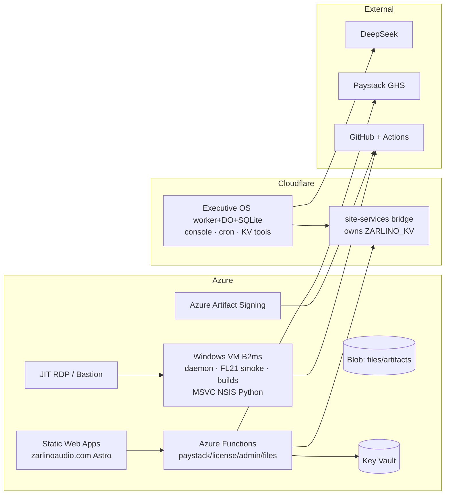

# DECISION — Azure Migration: HYBRID Execution Plan

**Date:** 2026-08-30 (replan after `dec_azure-migration-analysis.md`)
**Status:** APPROVED (hybrid)
**Goal:** Retire the Windows laptop. Move the laptop's role + the marketing website + data/signing to Azure. **Executive OS stays on Cloudflare.**

---

## 0. What the hybrid decision means (scope lock)

| Component | Where it lives after migration | Change? |
|---|---|---|
| Executive OS worker + DO + SQLite + KV + cron + console | **Cloudflare (unchanged)** | None to the deployed worker |
| `ZARLINO_KV` counters + affiliate (shared state) | **Cloudflare — new tiny "site-services" bridge worker** | New; owns the KV, exposes REST for Azure |
| Local agent daemon + FL + builds + ad-hoc agent work | **Azure Windows VM (always-on)** | Scripts run on VM; `local_deploy_website` repointed |
| Marketing website (`zarlinoaudio.com`) | **Azure Static Web Apps + Functions** | API ported from Worker → Functions |
| Files / artifacts | Azure Blob Storage | New |
| Secrets | Azure Key Vault (VM `.dev.vars` ok for daemon) | Consolidate |
| Code signing | **Azure Artifact Signing** ($9.99/mo) | Release workflow change |
| CI/CD | GitHub Actions (unchanged — already cloud) | Website deploy action swaps CF→Azure |
| Exec OS → Azure rewrite | **DEFERRED (not in hybrid)** | Backlog; go/no-go trigger in §6 |

**Design decision D1 — the KV bridge (the one architectural choice):**
The website and Executive OS share `ZARLINO_KV` (`revenue:*`, `aff:*`, `paystack:txn:*`, download/licensed counters). To let the website move to Azure without touching the Executive OS:
- Create a minimal Cloudflare worker **`zarlino-site-services`** that owns `ZARLINO_KV` and exposes `/v1/counters`, `/v1/affiliates/*`, `/v1/license/record`, guarded by a service token.
- Azure Functions (checkout/affiliate/admin) call it server-to-server.
- Executive OS keeps reading/writing KV directly as today — **zero worker change**.
- Rejected alternatives: moving counters to Azure (couples exec-os to Azure), or duplicating state (split-brain).

---

## 1. Target hybrid architecture



---

## 2. Pre-flight fact check (verified 2026-08-30)

- ✅ `tools/build-release-local.ps1` (needed by daemon `local_build_plugin`) is **missing from the working tree** but intact in git at `a118ce9d` (197 lines). **Must be restored in Phase 0.**
- ⚠️ Untracked in git right now: `WEBSITE/`, `artifacts/`, `_release_build.log`, `build-clean-zscorch/`. The "untracked = data loss" lesson has already hit twice (2026-08-28).
- ⚠️ `executive-os/scripts/local-agent.ts` `local_deploy_website` hardcodes Cloudflare `wrangler deploy` — must be repointed (Phase 2).
- ✅ zarlino-website deploys today via GitHub Actions (`deploy.yml` → wrangler) — cloud, no laptop in the loop.
- ✅ Plugin release gate already builds on GitHub `windows-2022` hosted runners (ZTame) — laptop-independent.

---

## 3. Phases (concrete)

### Phase 0 — Preflight & recovery (1–2 days)
1. **Restore release tooling:** `git checkout a118ce9d -- tools/build-release-local.ps1`; inspect/keep the `-Version` + generic-plugin edits; verify `build_pf_only.ps1`; commit. Then run `local_build_plugin ZTame` once to prove it works.
2. Commit or gitignore all untracked state (`WEBSITE/`, `artifacts/`, logs, `build-clean-zscorch/`); push all branches.
3. **Executive OS snapshot:** `GET /api/system/snapshot` (31 tables) → save to git/Blob. **KV dump script:** enumerate `aff:*`, `revenue:*`, `paystack:txn:*`, counters → JSON.
4. Secret inventory (names only): `DEEPSEEK_API_KEY`, `FOUNDER_AUTH_TOKEN`, `GITHUB_TOKEN`, `CF_API_TOKEN`, `PAYSTACK_SECRET_KEY` (live, GHS), `ZARLINO_LICENSE_PRIVATE_KEY`, `CLOUDFLARE_API_TOKEN/ACCOUNT_ID`, `ADMIN_TOKEN`. Decide: Key Vault for Functions/SWA; git-ignored `.dev.vars` on the VM for the daemon.
5. Azure: subscription → resource group → Key Vault → Managed Identity + RBAC.
6. **Gate:** `local_build_plugin ZTame` passes from a clean checkout; snapshot + KV dump downloaded and verified.

### Phase 1 — Azure VM replaces the laptop (2–3 days)
1. Provision Windows VM (`Standard_B2ms`, gen2, local region), 128 GB SSD.
2. Install toolchain (git, MSVC Build Tools + Windows SDK, cmake/ninja, NSIS, Python 3.14 + numpy/scipy, FL Studio 21 + license seat, Virtual Audio Cable for a fake audio device). Clone repos (Zarlino + submodules, zarlino-website, zarlino-feedback); `cmake -B build` once.
3. **Interactive session for FL:** autologon + Task Scheduler (interactive) starting the daemon via the existing VBS pattern.
4. Dev access: VS Code Remote-SSH (or JIT RDP + Bastion). **Keep Bastion OFF initially (JIT NSG + RDP = $0).**
5. VM daemon registers with live exec-os (heartbeat shows VM hostname); stop the laptop daemon.
6. **🏁 MILESTONE — "laptop is replaceable":** daemon on the VM claims a live local task, builds ZTame, runs `local_ship_check`, posts the result; verified from the live Executive OS. Laptop daemon stays off; keep the laptop as an offline backup for one week.
7. Note in exec-os docs: VM hostname replaces laptop; lease/reap machinery already handles an offline worker.

### Phase 2 — Website to Azure (3–5 days)
1. **Bridge first:** deploy `zarlino-site-services` on Cloudflare (owns `ZARLINO_KV`; `/v1/counters`, `/v1/affiliates/*`, `/v1/license/record`; service token in KV secrets). Verify exec-os counters still read correctly.
2. Scaffold SWA + Functions; port the Worker API (`paystack/initialize|verify`, `/api/license`, `/api/affiliates/*`, `/api/admin/*`, `/api/files`) to Functions; secrets from Key Vault; counters/affiliate via the bridge.
3. Update `deploy.yml` → `Azure/static-web-apps-deploy` + Functions deploy (remove wrangler step). SWA staging URL for parallel run.
4. E2E on staging: Paystack checkout (GHS), license build, affiliate enrol→report→approve→click→convert, admin stats, file upload.
5. DNS cutover `zarlinoaudio.com` → SWA custom domain (low TTL first). Verify `/admin` and the exec-os iframe still work.
6. Repoint `local_deploy_website` in `local-agent.ts` → trigger the GH Actions Azure deploy (`gh workflow run deploy.yml`) instead of `wrangler deploy` (machine-side change only — no worker redeploy).
7. After green: delete the old Cloudflare website worker; keep the bridge + exec-os.
8. **Gate:** full checkout + affiliate round-trip on the Azure URL; exec-os Overview counters unchanged.

### Phase 3 — Data, signing, CI consolidation (2–3 days)
1. Files/artifacts → Blob Storage (uploads + release zips + installers + A/B WAVs). Decide a size threshold where DB-base64 stops (5 MB cap today → Blob for anything larger).
2. **Azure Artifact Signing** into the release-gate workflow (managed HSM, MS root — see `dec_code-signing-distribution.md`); extend the ZTame gate pattern to ZScorch, ZVocals, PresenceField, RACK_AI; add `workflow_dispatch` everywhere.
3. CI stays GitHub Actions; add Azure Pipelines only if a hard requirement appears (not needed).
4. Key Vault = source of truth; Functions/SWA via Managed Identity; VM daemon via git-ignored `.dev.vars` (or env pulled from Key Vault — nice-to-have).
5. **Gate:** a full signed release (VST3 + Standalone + NSIS installer) produced entirely in the cloud, zero laptop involvement.

### Phase 4 — Decommission (1–2 days)
1. Final verification: snapshot compare, counters/affiliate parity, one live checkout.
2. **Rotate secrets** (several were pasted in chat historically): GITHUB_TOKEN, CF_API_TOKEN, PAYSTACK_SECRET_KEY if touched, DeepSeek key.
3. Stop laptop daemon permanently; wipe/archive the laptop (or keep as offline backup + second FL test rig).
4. Update docs + runbook: VM restart procedure, daemon restart, deploy commands (`az` / GH Actions), bridge worker lifecycle. Update repo memory.
5. **🏁 DEFINITION OF DONE:** laptop off; all green on Azure + Cloudflare; runbook committed; secrets rotated.

### Phase 5 — Deferred (explicitly NOT in hybrid)
Executive OS → Azure rewrite. **Trigger only if:** (a) Cloudflare costs exceed ~$25/mo, (b) single-cloud governance becomes a hard requirement, or (c) DO/SQLite limits bite on Workers Paid. If triggered: re-estimate from `dec_azure-migration-analysis.md` (2–4 weeks) with a go/no-go gate before starting.

---

## 4. Required code changes (small, enumerated)

| File | Change | When |
|---|---|---|
| `tools/build-release-local.ps1` | Restore from git `a118ce9d` + commit | Phase 0 |
| `.gitignore` / commit untracked (`WEBSITE/`, `artifacts/`, logs) | Commit or ignore | Phase 0 |
| New CF worker `zarlino-site-services` | New KV-bridge service | Phase 2 |
| `zarlino-website` API → Azure Functions | Port endpoints + Key Vault | Phase 2 |
| `zarlino-website/.github/workflows/deploy.yml` | wrangler → SWA/Functions deploy | Phase 2 |
| `executive-os/scripts/local-agent.ts` `local_deploy_website` | wrangler → `gh workflow run` (machine-side) | Phase 2 |
| Release-gate workflows | Add Azure Artifact Signing; extend to all plugins | Phase 3 |

**Executive OS deployed worker: no changes.** Machine-side scripts (`scripts/`, `tools/`) change only as listed.

---

## 5. Cost (hybrid, USD/month)

| Item | Cost | Notes |
|---|---|---|
| Windows VM B2ms (reserved 1-yr) | ~$40–55 | always-on daemon + dev |
| SWA | $0 | free tier |
| Azure Functions | ~$0–5 | pay-per-use, low traffic |
| Blob + Table | ~$1–3 | |
| Key Vault | ~$1 | |
| Azure Artifact Signing | $9.99 | 5k sigs/mo |
| Access | $0 | JIT RDP (skip Bastion) |
| **Azure subtotal** | **~$52–74** | |
| Cloudflare (exec-os, unchanged) | ~$0–5 | |
| **Total** | **~$55–80** | vs ~$0–5 today → **delta ~$50–75/mo (~$600–900/yr)** |

Dominant items: VM + signing. The delta is the price of retiring the laptop.

---

## 6. Hybrid-specific risks

1. **KV bridge split-brain** — counters/affiliate must have ONE owner post-cutover. Mitigate: bridge owns the KV exclusively; website Functions only via bridge; parity check before DNS cutover.
2. **`build-release-local.ps1` missing** — restore from git in Phase 0 or the daemon's core build tool is dead on the new VM.
3. **FL Studio on a VM** — license seat + no audio device + interactive-session requirement. Scope = launch smoke test only; real DAW host-compat stays on a physical machine.
4. **Two website deploy paths during transition** — run CF prod + SWA staging in parallel, cut over once, delete the CF website worker.
5. **exec-os local tools assuming Cloudflare** — only `local_deploy_website`; repoint in Phase 2 before any website deploy from the VM.
6. **VM cost creep / accidental dealloc** — the lease/reap machinery already re-queues tasks for an offline worker, but add budget alerts + reserved instance.
7. **Data loss recurrence** — the "untracked = data loss" pattern has hit twice; Phase 0 commits everything before anything else.

---

## 7. Timeline & definition of done

**~9–15 working days (~2–3 weeks)** to a retired laptop (vs 4–8 weeks for full-Azure):

```
Phase 0  Preflight & recovery ......... 1–2 d
Phase 1  Azure VM replaces laptop ..... 2–3 d   ← MILESTONE at end
Phase 2  Website → Azure .............. 3–5 d   ← bridge + SWA + cutover
Phase 3  Data/signing/CI .............. 2–3 d   ← fully cloud release
Phase 4  Decommission + rotate ........ 1–2 d   ← laptop OFF
```

**Done =** laptop off, daemon live on the VM, website on Azure with Paystack/affiliate verified, a signed release built fully in the cloud, exec-os untouched and healthy, secrets rotated, runbook committed.
