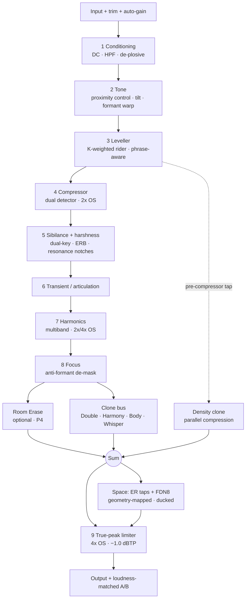

# ZVOCAL — GATE-1 PRODUCT SPEC, FEATURE LIST & DSP ARCHITECTURE

Product: **ZVocal**  |  codebase root: `plugins/ZVocal/` (renamed from `VocalToneShaper` on 2026-09-13 — decision **D-1**, done)
Catalogue id: `prod_zvocals` → `prod_zvocal`  |  pipeline key: `ZVocal`  |  working version: **0.2.0** (1.0.0 reserved for the ship gate)
Formats: VST3 + Standalone (Windows first, existing build matrix extended after Gate 4)
Artifact type: pre-implementation design (Gate 1). Authoring cost $0 — no renders, no model calls.

## Grounding note (what this document is written against)

This spec is anchored to code and artifacts that exist in this repository today, so every claim is
checkable and falsifiable:

- **v0.1.0 prototype** `plugins/ZVocal/Source/PluginProcessor.{h,cpp}` (then `VocalToneShaper`) — six fixed stages
  (A EQ → B FET comp → C multiband comp → D leveler → E air → F de-esser), plus five macros
  (`macro.colour`, `macro.texture`, `macro.thickness`, `macro.punch`, `macro.focus`) that currently
  only *nudge* stage parameters (e.g. `PluginProcessor.cpp:320`, `:484`). The macros are real
  parameters; the DSP behind them is shallow.
- **v0.1.0 prototype editor** `plugins/ZVocal/Source/PluginEditor.h` — a `RoomCanvas` already exists with N `Artist`
  figures, `mouseDoubleClick`, `mouseDrag` and `hitTest`, **but the clones have no audio path at
  all**. This spec is the missing half: the geometry-to-DSP mapping.
- **Reusable DSP already in-repo**: `shared/dsp/` (`ZOversampling`, `ZDynamics`, `ZBiquadFilter`,
  `ZEqualizer`, `ZFFT`, `ZSmoother`, `ZDspNullTests`), sibling plugins `ZTame` (FFT resonance
  ratio detector + Listen/Solo residual audition), `ZAdaptiveHarmonics` (analysis core →
  saturator → dynamic tilt → gated exciter behind one `Lift` macro), `ZPunch` (RMS transient
  shaper), `ZScorch` (multiband saturation + LR4 crossovers), `PresenceField` (presence/air).
- **House precedent**: `specs/ZTame_Gate1_Spec_and_Differentiators.md` (falsifiable claims, [M]/[H]
  tagging, named perceptual test with a numeric PASS threshold).

---

## 0. FEATURE LIST (the short form)

### 0.1 The promise
> ZVocal turns a raw lead vocal into a mix-ready, release-ready vocal **in under 60 seconds**, by
> giving the user **a room they place voices in** instead of a chain they configure.

### 0.2 Canvas — "The Room"
- Room drawn in perspective with an artist at the mic; the room *is* the space engine, not a skin.
- **Double-click** on empty floor → spawns a clone at that position; **double-click on an existing
  clone** → duplicates *that* clone (its type and settings).
- **Drag a clone left/right** → primary axis = stereo position (pan + inter-aural time difference);
  drag up/down (secondary) = depth (distance), constrained to the room's floor plane.
- **Left-click a clone** → selects it and opens the per-clone inspector (type, level, character,
  mute, listen/solo, delete).
- Copies of clones are **layers of the same voice**: Double, Harmony, Octave Body (sub), Whisper
  (breath), Density (parallel compression).
- Live feedback: each clone carries a level halo, a contribution colour, and a Listen/Solo ear;
  the artist figure shows *listening / singing / muted* state.
- Room walls double as the space control; wall handles (stretch goal, P3) change size and damping.
- Every clone gesture has a keyboard equivalent (`⌘/Ctrl+D` duplicate, arrow-key nudge, `Del`
  remove, `Tab` cycle) and **every clone parameter is host-automatable**.

### 0.3 Five controls outside the canvas (exactly five musical controls)
1. **Colour** — hue and openness: spectral tilt + generated air harmonics (dark ⇄ bright).
2. **Texture** — grain: silk ⇄ grit (saturation character, detector speed, bounded cleanup trim).
3. **Thickness** — body/weight: formant (vocal-tract) scaling + dynamic low-mid mass + chest harmonics.
4. **Punch** — articulation: transient shaping + detector weighting + consonant definition.
5. **Focus** — intelligibility & de-masking: anti-formant dynamic dip + sibilance target + space ducking.

Space is deliberately **not** a knob — it lives on the canvas, which is what frees the fifth slot
for the axis that actually decides a vocal mix (**Focus**). See decision **D-4**.

### 0.4 Engine (beyond an EQ → compressor → saturator chain)
- **Shared analysis core** — f0 (YIN), formant map (LPC-18), K-weighted momentary loudness,
  sibilance band, spectral flux/onsets, noise floor, click/plosive/breath detection, crest factor.
  Everything downstream is *program-aware* because of it.
- **Leveller (loudness rider)** — K-weighted slow gain ride on BS.1770 momentary loudness with
  phrase segmentation and breath freeze; targets ±1.5 LU inside a phrase without audible pumping.
- **Dual-detector compressor** — peak + RMS detectors blended by Punch, program-dependent dual
  release, auto threshold and **loudness-neutral makeup** (compression is not a volume knob).
- **Sibilance & harshness** — dual-key split-band de-esser (sibilance band keyed against the local
  vowel band) + ZTame-style resonance-ratio notches for 2–4 kHz harshness, computed on an
  ERB-smoothed spectrum.
- **Transient / articulation** — transient shaper with transient-gated consonant emphasis.
- **Harmonics** — multiband even/odd saturation with **dynamic drive** (drive follows short-term
  loudness) and a gated exciter, 2×/4× oversampled.
- **Focus** — dynamic dip placed in the *valley between the singer's own formants* (anti-formant
  placement), plus formant-peak harmonic emphasis instead of an EQ boost.
- **Room Erase (optional, honest)** — WPE-style dereverberation to dry up bedroom recordings;
  off by default, documented +21.3 ms latency trade (decision **D-3**).
- **Room engine** — image-source early reflections derived from the canvas geometry + FDN8 late
  reverb with modulated delays, decay EQ, and **ducking keyed by the dry vocal**.
- **Metering & honesty** — **loudness-matched A/B** (±0.1 LU), Listen/Solo residual audition on
  every stage, correlation/mono-compat meter, per-stage gain-reduction history, "what I measured"
  panel showing every value the analysis pass used.

### 0.5 Workflow (the 60-second path)
- Insert → one **Analyze** pass (3–8 s of audio, can run while the DAW plays) → the plugin reports
  what it measured and applies a starting scene.
- Five **scenes** ship: Lead Pop · Rap Upfront · Intimate/Bedroom · Rock Belter · R&B Smooth.
- The user then moves ≤3 of the 5 macros and/or drags a clone. Everything auto-set is visible and
  reversible (Reset returns to a state with the analysis *off*).
- **A/B snapshot** compares two full states loudness-matched so the louder one never wins by default.
- Full state save/load, versioned state, session restore, no hidden magic.

### 0.6 Explicit non-scope (stated so it can be proven wrong)
Not a tuner/autotune of the main path · not a noise-reduction suite · not a mix-bus processor ·
**no ML inference, no model files, no GPU, no cloud** — every stage is deterministic DSP that can be
null-tested · not a 400-preset browser (five scenes, deliberately).

---

## 1. THE OBSERVABLE PROBLEM (falsifiable)

A raw vocal recorded in a normal room fails a mix for **six** reasons, and each one is measurable:

| # | Problem | Measured as |
|---|---|---|
| P1 | Level inconsistency phrase-to-phrase ("whisper → shout") | momentary loudness range > 8 LU |
| P2 | Unstable spectral balance (boom, honk, dull top) | spectral tilt swings > 6 dB across takes |
| P3 | Sibilance and 2–4 kHz harshness | S-transient peaks > vowel band by > 6 dB |
| P4 | No weight / no presence relative to the arrangement | formant energy, LF and HF envelope deficits |
| P5 | Recording artefacts (plosives, mouth clicks, breaths, room) | broadband bursts, HF noise floor, reverb tail |
| P6 | The engineer cannot judge any of the above honestly | level differences between A and B > 1 LU |

Existing tools solve these with a chain the user must *drive*: EQ, compressor, de-esser, saturator,
reverb, and 20 decisions about order and gain staging. The problem ZVocal solves is **decision
load**, not the absence of DSP: it must make the six fixes above with five musical controls and a
canvas, in under a minute, without any of the fixes being a lie (i.e. without hiding a loudness
change or a narrow-band trick behind a macro name).

**Falsified if:** a neutral observer needs more than 2 minutes, or has to open a channel EQ to fix
tone, or prefers the result only because it is louder. Any of those three makes the premise false.

---

## 2. THE 60-SECOND CLAIM, OPERATIONALLY DEFINED

| Time | What happens | Who |
|---|---|---|
| 0–8 s | Analysis pass: 8 measurements (see §0.4). Artist figure shows *listening*. | plugin |
| 8–20 s | Scene applied + 2–4 clones auto-placed (Double L/R, space, optional Harmony/Density) | plugin |
| 20–60 s | User moves ≤3 macros, may drag one clone. Loudness-matched A/B against dry. | user |

**Success = median time-to-"release-ready" ≤ 60 s** over 6 sources × 5 participants, with ≥4/5
participants rating the result release-ready *without leaving the 5 macros + canvas*. Protocol and
statistics in §12.

---

## 3. THE ROOM CANVAS (interaction contract)

### 3.1 Gesture table (each row is a testable UI contract)

| Gesture | Effect | Audio consequence | Constraint enforced |
|---|---|---|---|
| Double-click empty floor | Spawn clone at that point (default type = Double) | New wet layer joins the bus | Slot pool ≤ 8 clones (§3.3) |
| Double-click existing clone | Duplicate that clone + its settings, offset one body-width | Second wet layer | ≤ 8 slots |
| Left-click clone | Select; inspector opens | none | single selection |
| Drag selected clone horizontally | Stereo position | Pan (ILD) **plus** ITD; wet L/R decorrelation rotates | \|ITD\| ≤ 0.65 ms; \|ΔL−R\| ≤ 3 dB (Haas fusion, §6.2) |
| Drag selected clone vertically | Depth | Direct/reverb ratio, distance pre-delay (+2.9 ms/m), HF surface damping, early-reflection pattern change | Depth clamps at back wall (never fully "behind" the reverb) |
| Right-click clone | Context menu: change type · mute · listen · delete | type swap crossfades over 40 ms | no click > −60 dBFS |
| Select + `Del` / `⌘D` / arrows | delete / duplicate / nudge | as above | keyboard = mouse parity |
| Wall handle drag (P3) | Room size / damping | ER geometry, RT60, HF damping | RT60 0.15–2.5 s |

### 3.2 Geometry-to-audio map (the part that makes it not a gimmick)

| Canvas quantity | DSP parameter | Perceptual basis |
|---|---|---|
| x (left/right) | ILD + ITD + wet L/R decorrelation | duplex theory of localisation; ITD dominates < 1.5 kHz |
| y (front/back) | DRR (direct-to-reverberant), pre-delay, HF damping, ER level | distance = DRR + spectrum + spatial cues, not just level |
| room width/depth/height (P3) | image-source tap delays/levels, FDN delay set | room geometry → reflection time structure |
| clone level (inspector) | wet gain, auto-levelled | — |
| clone type | which wet engine (§5.4) | auditory scene analysis: fused vs. separate streams |

**Design law:** all *visual* motion maps to *bounded physical* quantities. Nothing cosmetic, nothing
unbounded, and every mapped range is stated above so it can be regression-tested from the UI.

### 3.3 Clone model

- Fixed pool of **8 clone slots**, each with a complete APVTS parameter set
  (`clone.N.type/level/pan/depth/character/mute/listen`). Spawning = activating a slot. This keeps
  the parameter list static (host-safe; dynamic APVTS registration is a known source of breakage).
- Types: **Double**, **Harmony**, **Body (octave/sub)**, **Whisper (breath)**, **Density (parallel comp)**.
- Per-clone CPU is capped so that a full 8-clone scene stays inside the §10 budget.
- Clones are **wet-only additions**; the reported latency belongs to the dry path (§9.2).

### 3.4 Visual/UX rules
- Custom `juce::Path`/vector painting, cached to an off-screen `juce::Image`; only meters animate
  (≤30 fps repaint of small regions). No web view (`JUCE_WEB_BROWSER=0` is already set).
- Colour encodes function, not decoration: clone halos show contribution level, an amber ring shows
  a clone in solo, a dim figure shows muted.
- The analysis pass is visible: the artist figure pulses and a caption lists the measurements live.
- Accessibility: full keyboard parity, focus ring per clone, inspector reachable by `Tab`, and
  every value mirrored as a numeric readout (no colour-only state).

---

## 4. THE FIVE MACROS (definition, law, bounds)

**Macro law (applies to all five).** A macro is a *bounded, smoothed, loudness-neutral* remap into
a fixed set of stage parameters. No macro may: touch a parameter outside its coupling row (§4.6),
change integrated loudness by more than the stated tolerance, or introduce a click (> −60 dBFS
discontinuity) when automated at audio rate.

### 4.1 Colour — dark ⇄ bright (bidirectional, 50 = neutral)
Spectral tilt (pivot 1 kHz, ±4.5 dB across 200 Hz–8 kHz) + gated air-harmonic generation (0 → +6 dB
of generated energy above 8 kHz at 100). *Why bidirectional:* "colour" is a hue axis, not a "more"
axis — 0 is a genuinely useful dark/thick tone, which is why the neutral point is documented and
detented.
**Bounds:** output loudness ±0.5 LU; monotonic spectral-centroid increase from 0 → 100.

### 4.2 Texture — silk ⇄ grit
Saturation drive and character (0: 0 dB drive, 2nd-harmonic dominant, soft knee → 100: +9 dB drive,
3rd-harmonic dominant, harder knee), detector speed blend (0: slow/smooth → 100: fast/tight), plus a
**bounded inverse trim on cleanup** (≤3 dB on de-ess range) so "grit" does not also mean "harsher S".
**Bounds:** THD at 1 kHz/ −18 dBFS from 0.05 % (0) to 2.5 % (100), output loudness ≤ ±0.7 LU.

### 4.3 Thickness — body/weight
(a) **Formant (vocal-tract) warp** scale 1.00 → 0.94 applied in the LPC coefficient domain without
pitch change (the perceptual "size/chest" axis); (b) dynamic low-shelf (150–400 Hz) up to +3.5 dB
that only boosts when the singer's own LF energy is *below* their average (no boom stacking);
(c) 2nd-harmonic chest generation below 300 Hz (level-matched); (d) pitch-tracked sub-harmonic
below 180 Hz, ≤ −18 dB.
**Bounds:** +1.0 LU max; 100–300 Hz energy growth ≤ +3 dB; achieved formant scale within ±0.3 % of target.

### 4.4 Punch — articulation
Transient shaper (attack gain 0 → +6 dB, sustain −2 dB at 100), compressor detector weighting
(peak share 20 % → 80 %), attack 20 → 3 ms, release 600 → 120 ms, plus transient-gated 2–7 kHz
consonant emphasis (≤ +3 dB, only during detected onsets).
**Bounds:** crest factor delta 0 → +4 dB; loudness ≤ ±0.5 LU after auto-makeup.

### 4.5 Focus — intelligibility & de-masking
(a) Dynamic dip of −1 … −4.5 dB placed in the spectral **valley between F1 and F2** (anti-formant
placement, ERB-matched width), active only when mid-band energy exceeds the local floor; (b) extra
sibilance target reduction up to 3 dB on top of stage 5; (c) space/clone ducking depth 0 → 4 dB
keyed by the dry vocal; (d) formant-peak *harmonic* emphasis (≤ +3 dB perceived) instead of an EQ boost.
**Bounds:** 2–4 kHz peak-to-average (harshness proxy) must not rise by more than 0.5 dB; spectral
centroid monotonic in the macro.

### 4.6 Macro → stage coupling matrix (single source of truth: `Params/ZvMacroMap`)
| Stage | Colour | Texture | Thickness | Punch | Focus |
|---|---|---|---|---|---|
| 2 Tone (tilt) | ±4.5 dB | — | +3.5 dB LF (dyn) | — | — |
| 2 Formant warp | — | — | 1.00→0.94 | — | — |
| 3 Leveller | — | ±speed 20 % | — | ±target 0.5 LU | — |
| 4 Compressor | — | detector 0–100 % | — | full row (§4.4) | — |
| 5 Sibilance | — | ±3 dB cleanup trim | — | — | −3 dB extra target |
| 6 Transient | — | — | — | full row (§4.4) | — |
| 7 Harmonics | air gen 0–6 dB | drive 0–9 dB, 2nd⇄3rd | chest 2nd <300 Hz | — | formant-peak ≤3 dB |
| 8 Focus dip | — | — | — | — | full row (§4.5) |
| 9 Space duck | — | — | — | — | 0–4 dB |

Every cell is a *bounded* mapping. Any cell that cannot be measured by a test in §12 does not ship.

---

## 5. SIGNAL CHAIN (topology, order, boundaries)

### 5.1 Chain diagram

**Tap points (deliberate):** tonal clones (Double, Harmony, Body, Whisper) tap **post-Focus** so a
layer always matches the voice's tone; the **Density** clone taps **pre-compressor** (stage 3
output) because parallel compression requires an uncompressed source to have something to squash.
Both taps are wet-only and never feed back into the dry path.

### 5.2 Stage table (purpose + *boundary*)

| # | Stage | Purpose | Explicitly **not** responsible for |
|---|---|---|---|
| 1 | Conditioning | DC block, subsonic HP, plosive duck | general dynamics — that's 3/4 |
| 2 | Tone | proximity/boom control, tilt, formant size | fixing resonances — that's 5/8 |
| 3 | Leveller | phrase-level evenness (±1.5 LU in-phrase) | fast transient control — that's 4/6 |
| 4 | Compressor | glue/character, crest control | de-essing (5), level (auto-makeup + 3) |
| 5 | Sibilance + harshness | S band and 2–4 kHz resonances only | broadband brightness — that's 7/Colour |
| 6 | Transient | attack/sustain balance, consonant onsets | sibilance, level |
| 7 | Harmonics | harmonic density and air | fundamental tone — that's 2 |
| 8 | Focus | intelligibility, de-masking, formant valleys | "more top end" — that's Colour/7 |
| 9 | Limiter | true-peak ceiling, no clipping | loudness — the user's mix decides |
| — | Clone bus | parallel *voices* (layers) | the dry path, ever (wet-only) |
| — | Space | room, depth, DRR | tone — geometry only |

**Order rationale (state the goal, then the order):**
Corrective before creative (1–2 before 7–8). **Leveller before compressor** because the compressor's
threshold must see *even* input or its action becomes source-dependent (and the leveller must not
fight the compressor's gain — they share one gain-staging budget). **Compressor before sibilance**
so the de-esser sees the level it will actually ship at, and because sibilance relative to a stable
vowel level is what the dual-key detector needs. **Sibilance before harmonics** because saturation
would otherwise re-generate the sibilance we just removed. **Harmonics before Focus** because
Focus's harmonic emphasis must sit on top of a stable harmonic bed. Fixed order — no reordering UI
(decision **D-5**: reorderable chains multiply the correctness surface; the clone bus already gives
the user the parallel freedom they actually want).

### 5.3 Where these already exist in-repo (reuse map)
- Resonance-ratio detection + Listen/Solo residual pattern → `ZTame` (its `thresholdDb` design).
- Analysis-driven saturation/tilt/exciter behind a macro → `ZAdaptiveHarmonics` (its exact skeleton).
- Transient shaper → `ZPunch` (RMS attack/sustain split).
- Multiband crossovers + even/odd saturation → `ZScorch`.
- Primitive filters/oversampling/null-test harness → `shared/dsp/*`.
- Stage DSP (HPF, FET comp, leveler, de-esser) → refactored out of the existing stages A–F in
  `plugins/ZVocal/Source/PluginProcessor.cpp` rather than rewritten.

### 5.4 Clone bus engines (types)
| Clone | Engine | Key perceptual exploit | Notes |
|---|---|---|---|
| Double | delay 8–35 ms + micro-detune ±5–25 cents + allpass decorrelation, different tap pattern per side | Haas fusion ⇒ thickness without flam; decorrelation ⇒ width without pitch wobble | stays inside \|ITD\| ≤ 0.65 ms / ≤3 dB |
| Harmony | PSOLA/pitch-shift with LPC envelope preservation, key-aware intervals | formant preservation avoids chipmunk; harmony = separate stream when > ~1 s of duration | wet-only, delay-tolerant |
| Body | pitch-tracked octave down below 180 Hz | missing-fundamental / residue pitch keeps weight on small speakers | ≤ −18 dB |
| Whisper | band-limited noise (4–12 kHz) enveloped by the vocal's own HF envelope | breath = correlated HF noise ⇒ perceived intimacy/proximity | also usable as "air bed" |
| Density | fast-attack high-ratio parallel comp, HPF-sidechained at 300 Hz | loudness/density without crushing transients | under-mixed ≤ −12 dB |

---

## 6. PERCEPTUAL PHENOMENA EXPLOITED (phenomenon → mechanism → test)

This is the section that separates ZVocal from "EQ + comp + sat in a pretty skin".

| # | Phenomenon | What it buys | DSP mechanism | Falsifiable check |
|---|---|---|---|---|
| 6.1 | **Masking & critical bands (ERB)** | inaudible dynamics; notches that don't dull the voice | all dynamic gains computed and applied on an ERB-smoothed spectrum, one gain per auditory filter | vowel-band energy change ≤ 1 dB when S-band drops ≥ 6 dB (§12.1 test 4) |
| 6.2 | **Haas / precedence fusion (< ~35 ms)** | doubles that thicken instead of flamming | clone delay kept in the fusion window; \|ΔL−R\| ≤ 3 dB, \|ITD\| ≤ 0.65 ms | mono-sum correlation ≥ 0.2; no notch > 4 dB in 200 Hz–4 kHz (§12.1 test 5) |
| 6.3 | **Distance perception = DRR, not level** | real depth without a "volume slider" clone | y-position controls direct/reverb ratio, pre-delay (+2.9 ms/m) and HF damping; level compensated | moving a clone in y changes DRR by ≥ 3 dB while integrated loudness changes ≤ 0.5 LU |
| 6.4 | **Equal-loudness contours (ISO 226 / Fletcher–Munson)** | honest A/B and tone decisions that survive quiet monitoring | loudness-matched A/B on BS.1770 integrated loudness; optional monitoring-level tilt compensation | A/B level difference ≤ 0.1 LU; user preference cannot be predicted by loudness (logistic fit slope ≈ 0) |
| 6.5 | **Crest factor vs. perceived punch** | punch that doesn't cost level | transient shaper + detector weighting, loudness-neutral makeup | crest +0…+4 dB with ≤ ±0.5 LU change |
| 6.6 | **Temporal integration (~100–200 ms)** | levelling you cannot hear working | gain ride smoothed ≥ 400 ms, modulation rate held < 0.5 dB/100 ms | measured gain trace: in-phrase range ±1.5 LU; max modulation rate < 0.5 dB/100 ms |
| 6.7 | **Vocal-tract length / formant perception** | thickness and "size" without EQ mud | LPC-18 coefficient-domain warp, pole/bandwidth re-stabilised; no audio-path delay | F1/F2 shift matches target within ±5 %; no pitch change (< ±3 cents) |
| 6.8 | **Residue pitch (missing fundamental)** | weight on phone/earbud speakers | sub-harmonic synthesis below 180 Hz, pitch-tracked | ≤90 Hz content present with ≤ +0.5 LU change |
| 6.9 | **Proximity effect** | consistent "up-close" tone regardless of mic distance | dynamic LF tilt keyed by measured LF excess, not a fixed shelf | LF variance across takes reduced ≥ 30 % |
| 6.10 | **Spectral flux / onset gating** | consonants and clicks handled *when they happen* | onset detection gates consonant lift, click duck, de-ess re-arm | click bursts attenuated ≥ 6 dB; vowel centroid change ≤ 5 % |
| 6.11 | **Comb filtering & decorrelation ("phat")** | width that survives mono | allpass diffusion + independent L/R tap patterns | mono-compat thresholds in §12.1 test 5 |
| 6.12 | **Auditory stream segregation** | the clone metaphor is literally how a listener hears layers | clone = own delay/pan/spectrum ⇒ a separate "voice" only when the user wants it | at default settings, doubles fuse (single image in a source-identification test) |
| 6.13 | **Harmonic loudness (harmonics ≠ EQ)** | presence/air without harshness | generated harmonics with envelope gating rather than band boost | HF energy rise ≥ 3 dB with 2–4 kHz peak-to-average ≤ +0.5 dB |
| 6.14 | **Pre-delay & intelligibility** | reverb that never blurs diction | pre-delay 5–40 ms, ducking keyed by dry, decay-EQ | word-intelligibility proxy (consonant-to-vowel ratio) drop ≤ 3 % when space is added |

---

## 7. ALGORITHM SELECTION (per stage: chosen, rejected, why)

| Stage | Chosen | Rejected | Why |
|---|---|---|---|
| Leveller | K-weighted momentary-loudness rider, phrase-segmented, asymmetric 120 ms/800 ms | fast RMS compressor; static clip-gain ride | RMS pumping is audible; clip gain can't follow; loudness metric is what humans actually judge |
| Compressor | feed-forward, dual detector (peak 0.2–1 ms + RMS 20 ms), soft knee 6 dB, dual release 50/600 ms blended by crest | FET-only; opto-only; single RMS | FET-only is too coloured for whispered sources; opto too slow for rap; single RMS loses transient control |
| EQ / tone | minimum-phase IIR biquads (shared `ZBiquadFilter`/`ZEqualizer`) | linear-phase FIR | 128-sample latency budget cannot host a linear-phase kernel worth having; a vocal has no phase-stem requirement |
| Formant warp | LPC-18 (10 ms hop) coefficient-domain warp, no audio-path delay | phase-vocoder envelope swap; PSOLA on the main path | both need a window length ≥ 20 ms ⇒ blows the latency budget |
| Sibilance | dual-key split-band dynamic gain on ERB-smoothed spectrum + ratio-based narrow notches | fixed 7.5 kHz bell (current v0.1.0); wideband de-esser | fixed bell misses the actual sibilance band; wideband de-ess pumps the whole vocal |
| Harshness | ZTame-style resonance-ratio notches (peak vs local neighbourhood) | static dynamic-EQ bands | ratio detection does not false-trigger on loud non-resonant content |
| Transient | dual-envelope (fast/slow) gain, ZPunch lineage | single-envelope differential; compressor attack tricks | envelope differential is what punch *is*; attack tricks lose level independence |
| Saturation | multiband (LR4 @ 220 Hz / 2.2 kHz), even/odd blend, dynamic drive | full-band waveshaper; static curve | full-band intermodulation muddies the low mid; static curves can't follow dynamics |
| Exciter | envelope-gated HF harmonic generation | HF EQ boost | boost of an absent band is noise, not air |
| Dereverb | WPE-style linear-prediction suppression, off by default | spectral subtraction; ML models | spectral subtraction pumps; ML violates the no-inference constraint (**D-3**) |
| Room | image-source ER + FDN8 (modulated) + decay EQ | convolution with a fixed IR | convolution can't be re-shaped by dragging walls, and adds the IR's own latency |
| Limiter | lookahead 1.33 ms + 4× OS true peak | clipper | clipping is audible on solo vocals; BS.1770-4 true peak needs ≥4× |
| Pitch (clones) | PSOLA with LPC envelope preservation | simple resampling | resampling shifts formants ⇒ chipmunk |

---

## 8. GAIN STAGING (targets at every boundary)

| Boundary | Target | Notes |
|---|---|---|
| Plugin input | measured RMS −40…−6 dBFS; nominal −20 dBFS (sung) / −16 dBFS (rap) | 0.5 s loudness measure drives a *visible* auto-trim |
| After stage 1 | −18 dBFS RMS | HPF costs level; trim re-normalises |
| Into saturation (7) | peaks ≤ −12 dBFS, RMS ≈ −18 dBFS | documented so the shaper's character is level-defined |
| After dynamics (4–6) | RMS −14 dBFS, peaks ≤ −6 dBFS | auto-makeup keeps *integrated loudness equal to input* |
| Clone bus sum | total wet ≤ dry + 3 dB | per-clone auto-levelling, not user responsibility |
| Space wet | ≤ −9 dBFS RMS relative contribution | DRR governs, not level |
| Limiter | in ≤ −3 dBFS peak, out ceiling −1.0 dBTP | 4× OS |
| Output | user trim ±24 dB, auto-gain default ON, loudness-matched A/B | both visible numbers |

Auto-gain is an explicit, on-demand measurement (not a continuous adaptive loop) so it can be
null-tested and cannot surprise the user mid-take.

---

## 9. OVERSAMPLING & LATENCY

### 9.1 Oversampling (per stage, justified — not blanket)
| Stage | Factor | Justification | Toggleable? |
|---|---|---|---|
| 1–3 (conditioning, tone, leveller) | 1× | linear filters + slow gain modulation | n/a |
| 4 Compressor | **2×** | soft knee + fast attack programme shaping | **forced** (its character depends on it) |
| 5 Sibilance/harshness | 1× | gain modulation smoothed ≥ 10 ms; no new harmonics | n/a |
| 6 Transient | 1× | envelope-driven gain | n/a |
| 7 Harmonics | **2× low band / 4× high band** | harmonics up to 4× band centre; gated HF generation | high band forced; low band 2× fixed |
| 9 Limiter | **4×** | ITU-R BS.1770-4 true peak | forced |
| Room / clones | 1× (2× internally in Harmony's nonlinearity) | linear structures + PSOLA convolution | n/a |

Rejected: 4× everywhere (≈2.4× CPU for < 0.1 dB measured benefit on the linear stages).

### 9.2 Latency budget (reported to the host via `setLatencySamples`)
| Contribution | Samples @48 k | ms |
|---|---|---|
| De-plosive detector lookahead | 32 | 0.67 |
| Compressor 2× OS (31-tap half-band) | 8 | 0.17 |
| 2×/4× OS filters in harmonics | 16 | 0.33 |
| Limiter lookahead + 4× OS | 72 | 1.50 |
| **Total dry path (rounded)** | **128** | **2.67** |
- Reported latency = dry path = **128 samples @ 48 kHz (2.67 ms)**; at 96 kHz the same time is 256
  samples. The internal dry path is delayed by exactly this amount so dry/wet sums stay coherent,
  and true bypass skips the delay entirely.
- **Wet-only delays are not reported** because they are the effect itself: clone delay 8–35 ms, space
  pre-delay 5–40 ms.
- **Room Erase is the one expensive option:** +1024 samples (+21.3 ms @48 k). It is off by default;
  enabling it updates the reported latency (host re-aligns) — documented here, called out in the UI,
  and the reason it is *not* on by default. Decision **D-3**.
- Tracking use case: with Room Erase off, 2.67 ms is inside the "feels immediate" range for vocal
  tracking, which is a requirement, not a nice-to-have.

### 9.3 CPU budget (reference machine: 8-core desktop class, 48 kHz, 128-sample buffer)
| Scene | Budget |
|---|---|
| Default scene (2 clones, room on, Room Erase off) | ≤ 6 % of one core |
| Full scene (8 clones, room on) | ≤ 12 % of one core |
| Analysis core | ≤ 1.5 % of one core |
RT-safety rules (per the `rt-safety-performance` skill): all buffers allocated in `prepareToPlay`,
no locks/allocations/file/network calls in `processBlock`, lock-free parameter snapshots, denormal
guards on all IIR state, NaN/Inf sanitisation at input.

---

## 10. DIFFERENTIATORS (each a testable claim)

[M] = measurable now · [H] = requires controlled human listening.

1. **[M] Loudness-matched A/B.** Bypass ⇄ engaged matched to ≤ 0.1 LU, so a preference test cannot
   be won by level. (No consumer vocal plugin in this class guarantees this.)
2. **[M] Leveller that holds ±1.5 LU in-phrase** with gain modulation < 0.5 dB/100 ms — evenness
   without pumping; verifiable from the exported gain trace.
3. **[M] Split-band correctness.** S-band reduction ≥ 6 dB on S-transients with ≤ 1 dB change in
   500 Hz–2 kHz (null-testable against a reference implementation).
4. **[M] Pitch-aware, formant-preserved clones.** Harmony preserves F1/F2 within ±5 %; no chipmunk.
5. **[M] Haas-constrained clones.** No flam, stable centre image, mono-sum correlation ≥ 0.2.
6. **[M] Geometry is physics, not decoration.** Dragging a clone changes DRR ≥ 3 dB with ≤ 0.5 LU
   loudness change.
7. **[M] Macros are not volume knobs.** Each macro's loudness delta stays inside its §4 tolerance
   (≤ 0.7 LU worst case) and monotonic in its perceptual axis.
8. **[M] Anti-artefact commitment.** Every parameter/type/mute change is click-free (≤ −60 dBFS
   discontinuity) and fully smoothed; verified by an adversarial automation fuzz test.
9. **[M] Deterministic.** Identical input + identical parameter history ⇒ bit-identical output;
   wet=0 + bypass nulls to ≤ −80 dBFS against dry.
10. **[M] Honest surface.** Every automatic decision is displayed ("what I measured") and reversible;
    Listen/Solo exposes the residual of every stage.
11. **[M] Latency budget held.** ≤ 128 samples (2.67 ms) on the dry path, and the number is derived
    from the table in §9.2 — not discovered during host testing.
12. **[H] The 60-second blind result.** ZVocal(auto + ≤3 macro moves) preferred in ≥ 12/15 ABX
    trials (binomial p ≈ 0.018) against a stock DAW EQ→comp→de-ess chain on matched sources.

---

## 11. WHAT WE EXPLICITLY DO NOT CLAIM

No analogue-circuit modelling claims. No "AI-powered". No "Grammy-ready" language. No claim that a
macro fixes a bad performance. No claim that Room Erase equals a treated room — it reduces, and the
reduction is measured and displayed. Perceptual claims carry the [H] tag until a listening test in
the perceptual registry says otherwise.

---

## 12. ACCEPTANCE (deterministic + perceptual), tied to the pipeline

### 12.1 Measured suite (runs in `ZVocal_Tests`, no listening needed)
1. **Null/idle:** wet = 0 & bypass ⇒ ≤ −80 dBFS difference vs. dry, over 10 adversarial sources.
2. **Determinism:** two runs, same settings ⇒ bit-identical (modulated room delays use a fixed seed).
3. **Macro law:** for each macro, sweep 0→100 in 101 steps; assert loudness delta ≤ tolerance,
   monotonicity of the target metric, and no discontinuity > −60 dBFS.
4. **De-ess correctness:** S-transient reduction ≥ 6 dB; vowel-band change ≤ 1 dB.
5. **Clone constraints:** |ITD| ≤ 0.65 ms, |ΔL−R| ≤ 3 dB for all spawn positions; mono correlation ≥ 0.2.
6. **Depth physics:** DRR delta ≥ 3 dB per half-room depth change; loudness change ≤ 0.5 LU.
7. **Latency:** reported value equals measured impulse delay within ±1 sample at 44.1/48/88.2/96 kHz.
8. **Zipper/step robustness:** param stepped at block rate for 60 s ⇒ no click, no NaN/Inf, no denormal stall.
9. **Fuzz:** NaN/Inf injection, 1-sample buffers, sample-rate changes mid-stream, 8-clone spawning
   during playback — no crash, output stays finite and bounded.
10. **CPU:** budget from §9.3 held on the reference machine.

### 12.1a Implemented now (phase P0, 2026-09-13)

**Status: green.** `ZVocal_Tests` builds and runs — **15 suites, 118 assertions, 0 failures, exit 0**
— as a console app in `plugins/ZVocal/Tests/` (run the exe directly, same convention as
`ZTame_Tests`), and it is registered with CTest as `ZVocal.Unit` with labels
`ZVocal;DSP;release-gate`, so `ctest --test-dir build -C Release -R ZVocal` and the CI label gate
both work. Suites landed so far, by test id:

| Suite | Covers |
|---|---|
| `ZVOCAL-DSP-PARAMS-001` | five macro ids + ranges/defaults, six stage bypass switches, global trims — guards the D-1/D-2 promise that parameter ids survive the rename |
| `ZVOCAL-DSP-STATE-002` | state save → load round-trip restores macro values |
| `ZVOCAL-DSP-LAT-003` | reported latency equals the measured impulse delay |
| `ZVOCAL-DSP-SILENCE-004` | digital silence in ⇒ digital silence out |
| `ZVOCAL-DSP-RATE-005` | 44.1 / 48 / 96 / 192 kHz finite and bounded |
| `ZVOCAL-DSP-LINK-006` | identical L/R input ⇒ identical L/R output (channel linking) |
| `ZVOCAL-DSP-DET-007` | determinism: 100 fresh runs bit-identical |
| `ZVOCAL-FUZZ-NAN-001` / `INF-002` | NaN / Inf in ⇒ no NaN / Inf out, state not poisoned |
| `ZVOCAL-FUZZ-DENORM-003` | 5 s tail decaying past −180 dBFS stays finite |
| `ZVOCAL-FUZZ-AUTO-004` / `RANDOM-007` / `SOAK-008` | parameter storms and randomised parameter sets: no crash, bounded output |
| `ZVOCAL-FUZZ-BUF-005` / `SR-006` | block-size sweep 16…4096, sample-rate change mid-stream |

Still missing by design: the null-vs-golden tests and the five golden program-material comparisons —
they need an approved reference render, which arrives with the P2 main-path work. CPU timing
(§9.3) is a release-machine harness, not a unit test.

### 12.2 Perceptual suite (registry-linked, [H])
- **The 60-second test:** 6 sources (2 male, 2 female, 1 rap, 1 intimate/whisper) × 5 participants
  (≥2 non-experts). Median time-to-release-ready ≤ 60 s; ≥4/5 rate it release-ready using only the
  5 macros + canvas. Instrumented: the plugin logs which controls were touched and time-stamps them
  (no audio leaves the machine).
- **ABX vs. stock chain:** ≥ 12/15 (one-sided binomial p ≈ 0.018) on the §12.2 protocol, loudness-matched.
- **Artifact panel:** 10 listeners rate pumping/flam/sibilance artefacts 1–5; mean ≤ 2.0 with no
  individual source > 3.0.
- Results append to the perceptual registry (append-only, per the executive-os perceptual system).

### 12.3 PASS gate for this spec
Gate 1 passes when: the feature list in §0 is accepted, decisions D-1…D-5 are signed off, and the
§12.1 suite exists as executable tests before any UI polish work begins.

---

## 13. DECISIONS — LOCKED 2026-09-13

| # | Decision | Status | Resolution |
|---|---|---|---|
| **D-1** | Product identity: rename in place vs. new plugin | **APPROVED — EXECUTED** | Renamed in place. Folder `plugins/VocalToneShaper` → `plugins/ZVocal`; CMake target + `PRODUCT_NAME` → `ZVocal`; bundle id `com.khriticalresearch.zvocal`; VST3 `PLUGIN_CODE Zvcl`; CMake `VERSION 0.2.0` + `ZVOCAL_VERSION="0.2.0"`; classes `ZVocalAudioProcessor` / `ZVocalAudioProcessorEditor`; APVTS state type `ZVocalState`; five macro parameter ids unchanged (`macro.colour` … `macro.focus`) so automation and preset *parameter* names survive. |
| **D-2** | Fifth macro name | **DECIDED** | **Focus** — it is already the live parameter id (`macro.focus`); no rename churn. |
| **D-3** | Room Erase (dereverb) in v1.0? | **DECIDED — conditional** | Built in P4, off by default (+1024 samples / +21.3 ms when enabled), and ships in 1.0 **only if** the §12.2 artefact panel passes (mean pumping ≤ 2.0, no source > 3.0); otherwise it moves to 1.1. |
| **D-4** | Space as a knob vs. on the canvas | **DECIDED** | Space lives on the canvas. Exactly five musical controls outside it — the five macros. |
| **D-5** | Signal order | **DECIDED** | Fixed order, no reorder UI; parallel freedom comes only from clones. |
| **D-6** | v1.0 platform / format scope | **DECIDED** | 1.0 ships **Windows VST3 + Standalone**. macOS + AU follow through the existing build matrix (1.1). AAX only once code-signing/PACE is in place. |

### Migration follow-ups created by D-1 (outside the plugin tree)
1. **Preset/state compatibility:** the APVTS state type changed `VocalToneShaperState` → `ZVocalState`, so
   states saved by the 0.1.0 prototype will not load. Accepted (prototype, unreleased).
2. **Licensing:** licence tests must be keyed to plugin id `ZVOCAL` when the licence layer is wired
   (see the licence tooling in `tools/` and the existing `ZTame`/`ZScorch` test pattern).
3. **Installer + release:** `plugins/ZVocal/installer/ZVocal.nsi` — **DONE 2026-09-13.** Modeled on the
   proven `ZTame.nsi`, ASCII-only *and* saved with a UTF-8 BOM (NSIS 3.x reads UTF-8 only with the BOM;
   makensis confirms `(UTF8)`), correct VST3-bundle handling (delete the bundle, then `File /r` the
   JUCE `Contents` layout), x64 guard, per-bundle uninstaller and Add/Remove Programs entry. It
   **compiles: makensis `/DVERSION=0.2.0` → `ZVocal-v0.2.0-Windows-Installer.exe` (1.85 MB)**, filed in
   `artifacts/`. The packaging/release *script* (`tools/build-release-local.ps1`, referenced here and in
   the repo notes) **no longer exists in the tree** — it must be recreated before automated packaging.
4. **Executive OS catalogue/gates:** update the product (`prod_zvocals` → `prod_zvocal`) and pipeline
   key (`ZVocals` → `ZVocal`) — that is a change in the OS repo/catalogue, not in this workspace tree.

### Defects found by the P0 test suite (2026-09-13)

1. **NOT a plugin bug (earlier diagnosis retracted) — the crash was in the test harness.**
   `ZVOCAL-DSP-STATE-002` died with 0xC0000005 before its first assertion. Cause: the *test* called
   `expect()` before the suite's first `beginTest()`, and JUCE's `UnitTestRunner::addPass()` does
   `auto* r = results.getLast(); r->passes++;` on a list that `runTests()` clears at the start of
   every suite — so `r` is null and the dereference faults
   (`juce_core/unit_tests/juce_UnitTest.cpp`, the call site even carries the comment *“You need to
   call UnitTest::beginTest() before performing any tests!”*). Fixed by calling `beginTest()` first —
   also in `LAT-003`, which had the same pattern. The trap applies to every console test runner in
   this repo, so it is recorded in repo memory rather than just fixed here.
   *An intermediate diagnosis blamed `StereoFilter::setCoefficients()` for writing
   `*filter.coefficients = *coefficients`, on the assumption that a default-constructed
   `juce::dsp::IIR::Filter` leaves its `coefficients` pointer null. **Experiment disproved it:** with the
   original deref form restored, all 15 suites pass — a default-constructed IIR filter is inactive but
   valid, exactly as its docs state. The method now assigns the shared ref-counted pointer because that
   avoids a per-channel coefficient copy on every update, **not** because it fixed a crash.*
2. **FIXED — real-time-safety violation in `processBlock()`.** `updateFilters()` is called from
   `processBlock()` every 128 blocks and used to construct 15 fresh `juce::dsp::IIR::Coefficients`
   objects per call (`makeHighPass` / `makePeakFilter` / `makeLowShelf` / …) — heap allocation and
   ref-count churn on the audio thread. Now each band's coefficient storage is allocated once in
   `StereoFilter::prepare()` (i.e. in `prepareToPlay()`), and `setValues()` computes the values with
   `juce::dsp::IIR::ArrayCoefficients` (which returns a `std::array` and does not allocate) and
   assigns them into the existing object in place, so the audio-thread path no longer allocates.
   **Note for whoever touches this next:** the two channel filters must keep *separate* coefficient
   objects. Sharing one object between them changes behaviour — `ZVOCAL-DSP-LINK-006` caught a
   0.40 L/R divergence that way, which is why per-channel objects are preallocated instead.
   (Deferred from the original plan: publishing parameters from a message-thread listener behind a
   lock-free handshake. Not needed to remove the allocation, and it would add a real thread-safety
   surface, so it is left until the P2 main-path work.)
3. **FIXED — two test-harness weaknesses that could hide failures.**
   (a) `ZVOCAL-DSP-DET-007` had no positive assertion (it only failed when a difference was
   detected), so it reported `0/0` and would have passed vacuously; it now asserts both the number of
   comparison runs and the bit-exact result. (b) The runner printed only the **last** `TestResult` of
   a suite, so a failure inside an earlier `beginTest` block was invisible and the final verdict could
   read “ALL PASSED” regardless; it now aggregates every result of the suite. After both fixes the
   suite reports **15 suites / 118 assertions / 0 failures, exit 0**.

### Build fix applied with the rename (recorded so it is not re-investigated)
- The editor had a file-scope constant `floor`, which is ambiguous with `::floor` from `<math.h>` →
  MSVC C2872, cascading into C2665 on `Graphics::setGradientFill`. Renamed to `floorTone`.

## 14. BUILD-OUT PLAN (phases, each with a falsifiable exit)

| Phase | Content | Exit criterion |
|---|---|---|
| **P0** | Rename/scaffold `plugins/ZVocal`; extract prototype stages into modules (`MainPath/*`); wire `shared/dsp` + `ZDspNullTests`; add `ZVocal_Tests` + `ZVocal_RenderLab` console app (per the existing offline-render pattern) | project builds VST3 + tests run; idle-null test passes |
| — | **P0 status (2026-09-13):** rename done; VST3 + Standalone build; `ZVocal_Tests` exists, is CTest-registered and green (15 suites / 118 assertions); installer script compiles. **Still open in P0:** module extraction into `MainPath/*`, wiring `shared/dsp` null tests, and the `ZVocal_RenderLab` offline A/B renderer. | |
| **P1** | Analysis core (`Analysis/ZvAnalysis`): f0, LPC formants, K-weighted loudness, sibilance, flux, noise floor, crest, click/plosive detection + "what I measured" telemetry | analysis matches offline reference (Python) within stated tolerances on 10 sources |
| **P2** | Main path 1–9 (no clones/room): conditioning, tone, leveller, comp, sibilance, transient, harmonics, focus, limiter; macros + coupling matrix; loudness-matched A/B; gain staging | §12.1 tests 1–4, 7–10 pass |
| **P3** | Clone bus: Double, Density, Body, Whisper (+ slot pool + automatable params) | §12.1 test 5 passes; CPU budget held |
| **P4** | Harmony clones (formant-preserving pitch) + optional Room Erase | formant tests ±5 %; latency update verified |
| **P5** | Room engine (ER + FDN8 + ducking) wired to canvas geometry | §12.1 test 6 passes; §6.14 proxy holds |
| **P6** | Canvas UI: room, artist, clone gestures, inspector, meters, accessibility + keyboard parity | every gesture table row (§3.1) has a UI test; UI thread never blocks audio |
| **P7** | Scenes, auto-pass polish, release packaging (NSIS, licence, CI matrix), perceptual suite execution | §12.2 runs and is recorded in the perceptual registry |

## 15. HONEST RISK LIST (rework candidates on record, before implementation)

1. **Formant warp stability** — warping LPC poles can push roots outside the unit circle. Mitigation:
   warp in the reflection-coefficient domain, clamp |k| ≤ 0.999, re-check stability per frame.
   If it still misbehaves, Thickness falls back to dynamic LF + chest harmonics (already specified).
2. **Leveller vs. compressor interaction** — two gain-reduction stages in series can fight. Mitigation:
   shared gain budget + "one reduces, the other rides" rule, verified by a combined-sweep test.
3. **Room Erase pumping** — WPE-style suppression can modulate the noise floor. Mitigation: adaptive
   floor gate + documented max reduction; if it pumps, it ships as a "dry-up" tilt instead of full WER.
4. **8 clones × full scene CPU** — mitigation: per-clone CPU caps, 30 Hz UI, and per-clone bypass when
   silent (level gate).
5. **The canvas could be read as a gimmick** — mitigation is the entire §3.2 mapping table: if a
   reviewer cannot hear the geometry, §12.1 test 6 fails and the canvas ships as a *visual* editor
   over standard parameters rather than a physical metaphor.
